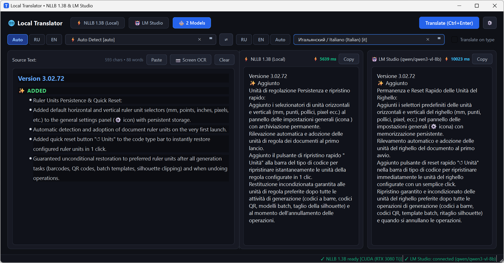
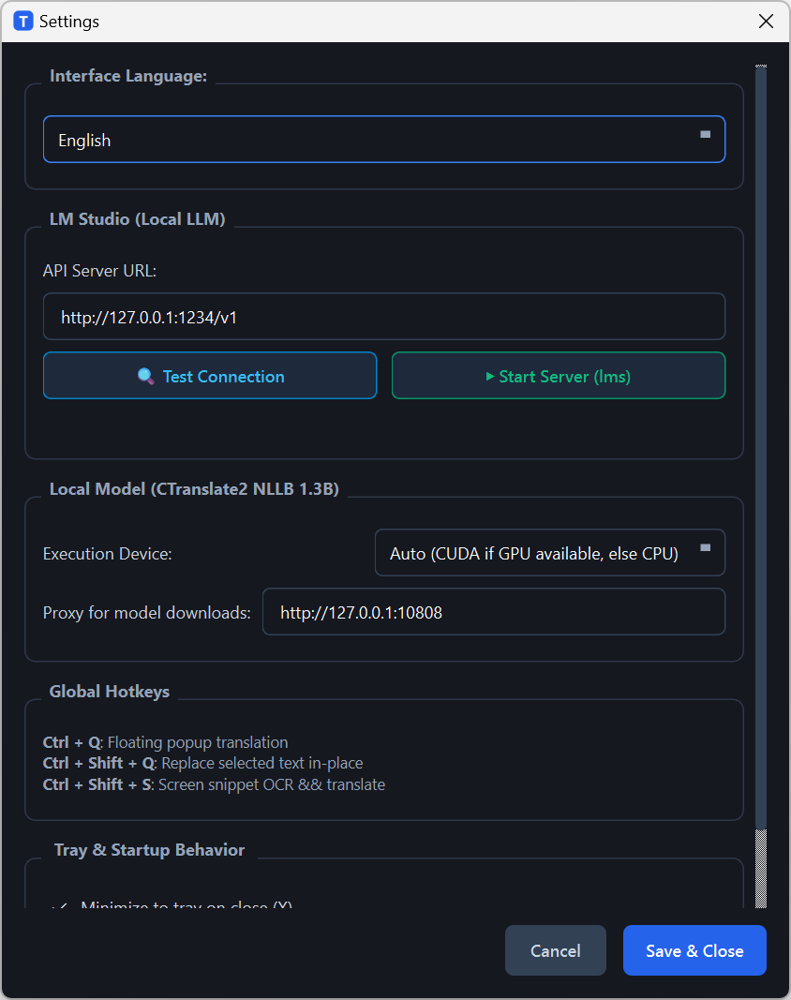
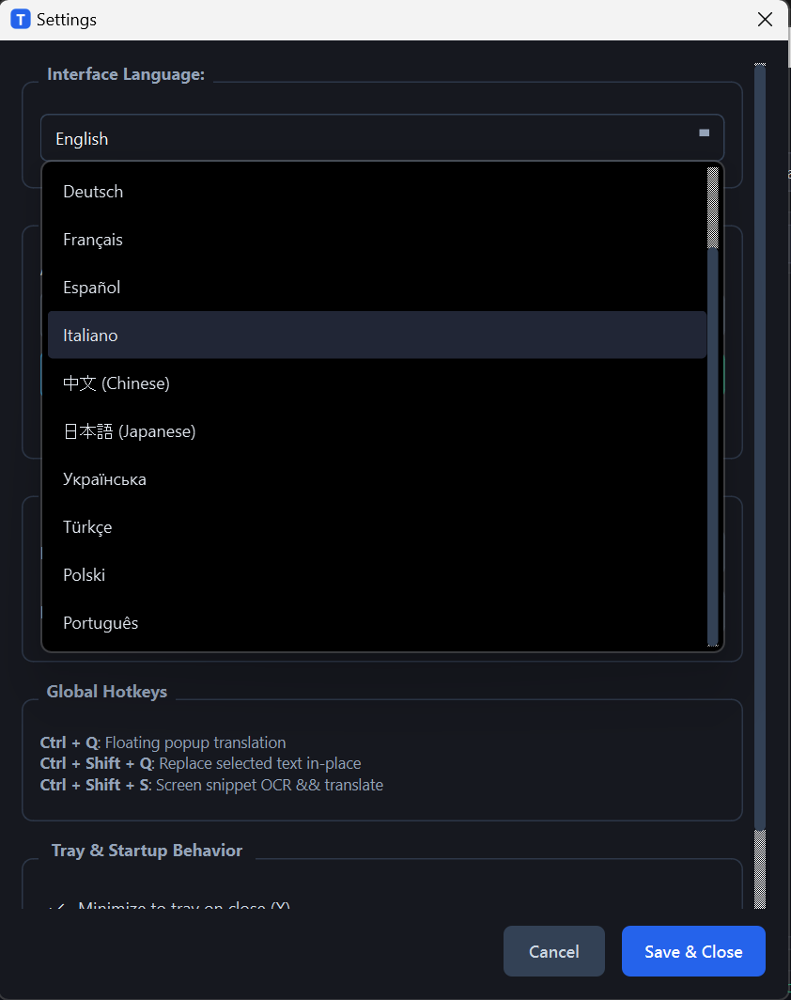

# 🌐 Local Translator • NLLB 1.3B & LM Studio (Vision OCR)

<p align="center">
  
  
  
  
  
  
  
  
</p>

<p align="center">
  <b><a href="#english">English Documentation</a></b> | <b><a href="#русский">Русская документация</a></b>
</p>

---

<a name="english"></a>
# English

**Local Translator** is a fast, 100% private, and feature-rich desktop translation tool for Windows in the spirit of the classic *QTranslate*. It seamlessly pairs high-speed offline neural machine translation (**Meta NLLB-200 1.3B INT8** via **CTranslate2**) with any local Large Language Models and Vision-Language models running in **LM Studio**.

## 📸 Screenshots

<p align="center">
  <b>Side-by-Side Dual Model Comparison (NLLB 1.3B & LM Studio with Latency Metrics) & Screen OCR</b><br>
  
</p>

<p align="center">
  
  &nbsp;
  
  <br>
  <i>Left: Engine & Hardware Settings (CUDA / CPU / LM Studio / Hotkeys). Right: 12 Interface Languages selector.</i>
</p>

---

## 🌟 Key Features

### 1. ⚡ Ultra-Fast Offline Neural Translation (Meta NLLB-200 1.3B)
* Runs **100% locally and offline** — zero telemetry, zero cloud data transfer.
* Accelerated by **CTranslate2** with NVIDIA CUDA (GPU) or optimized CPU INT8 execution.
* Near-instant translation with typical latencies of **30–80 ms** on modern GPUs.

### 2. 🤖 LM Studio Integration (Local LLMs)
* Connects directly to LM Studio’s OpenAI-compatible local API server (`http://127.0.0.1:1234/v1`).
* Use any loaded LLM (Qwen 2.5, DeepSeek, Llama 3, Gemma 2, Mistral, etc.) with smart translation prompting and automatic fallback.

### 3. ⚖️ Side-by-Side Dual Model Comparison (2 Models)
* Translates text with both **NLLB-200** and **LM Studio** simultaneously.
* Displays both outputs side-by-side with real-time response latency metrics in milliseconds (`⚡ ms`) and one-click copy buttons.

### 4. 📷 Screen Snippet OCR via Vision-Language LLM (`Ctrl+Shift+S`)
* Built-in snipping overlay tool with multi-monitor and High-DPI physical coordinate support.
* Drag to select any text area on your screen (PDF, video subtitles, games, scanned documents).
* The screenshot is sent directly to LM Studio's multimodal endpoint (`/v1/chat/completions`) using vision models like **Qwen2-VL**, **MiniCPM-V**, **LLaVA**, or **Phi-3.5-Vision**.
* **Two-in-One Workflow**: recognized text is instantly placed into the **Source Text** window (available for copying/editing) and automatically translated into your target language!
* Also supports pasting screenshots directly from the clipboard.

### 5. 🎯 Floating HUD at Cursor (`Ctrl+Q`) & In-Place Replacement (`Ctrl+Shift+Q`)
* **`Ctrl+Q`**: Select text anywhere in Windows (browser, chat, document) and press `Ctrl+Q` to pop up a dark-mode floating HUD with instant translation right under your cursor.
* **`Ctrl+Shift+Q`**: Instantly replaces selected text in-place with its translation.

### 6. 🌍 200+ Languages with Intelligent Search
* Full FLORES-200 language coverage (202 languages).
* Smart substring autocompletion and recent language history pinning.
* **Locale-Aware Display**: Shows English names first (`German / Deutsch (Немецкий) [de]`, sorted A–Z) when using an international UI language, and Russian first (`Немецкий / Deutsch (German) [de]`, sorted А–Я) in Russian mode.
* Dedicated quick-switch buttons for **RU**, **EN**, and **Auto**.

### 7. 🌐 12 User Interface Languages
* Fully localized GUI with on-the-fly switching in Settings:
  English (default), Русский, Deutsch, Français, Español, Italiano, 中文 (Simplified), 日本語, Українська, Türkçe, Polski, Português.

### 8. 🖥️ Windows Tray & Silent Background Mode
* Minimizes to the system tray on close or starts minimized on Windows boot.
* Right-click tray menu provides quick access to Translator, Screen OCR, Settings, and Cache clearing.

---

## ⌨️ Global Shortcuts

| Shortcut | Action | Description |
|---|---|---|
| <kbd>Ctrl</kbd> + <kbd>Q</kbd> | **Popup Translation** | Shows floating translation window near cursor for selected text |
| <kbd>Ctrl</kbd> + <kbd>Shift</kbd> + <kbd>Q</kbd> | **Replace In-Place** | Translates and replaces selected text directly in the active app |
| <kbd>Ctrl</kbd> + <kbd>Shift</kbd> + <kbd>S</kbd> | **Screen Snippet OCR** | Dims screen, captures selected rectangle, extracts text via Vision LLM & translates |
| <kbd>Ctrl</kbd> + <kbd>Enter</kbd> | **Translate** | Triggers translation in the main window |
| <kbd>Esc</kbd> | **Dismiss / Cancel** | Closes popup, settings dialog, or cancels screen snipping |

---

## 🚀 Quick Start

### Option A: Run Pre-Built Portable Executable (Recommended)
1. Download **[LocalTranslator-v1.0.0-windows-x64.zip](https://github.com/SaidAuita/LocalTranslator/releases/latest)** from the latest GitHub Release.
2. Extract the archive into any folder on your PC.
3. Run `LocalTranslator.exe`.
4. If the NLLB model is not yet downloaded, click the **Download 1.3B Model** banner in the UI (downloads ~1.38 GB directly with pause/resume support).

### Option B: Run from Python Source

```bash
# 1. Clone repository
git clone https://github.com/SaidAuita/LocalTranslator.git
cd LocalTranslator

# 2. Create virtual environment
python -m venv .venv
.venv\Scripts\activate

# 3. Install requirements
pip install -r requirements.txt

# 4. Launch
python main.py
```

---

## 🤖 Configuring LM Studio & Vision LLM OCR

### Text Translation via LM Studio
1. Launch **[LM Studio](https://lmstudio.ai/)**.
2. Download any text model (e.g. `Qwen2.5-7B-Instruct`, `Llama-3.1-8B-Instruct`, `Mistral-7B`, etc.).
3. Go to the **Developer / Local Server** tab in LM Studio and click **Start Server** (default: `http://localhost:1234`).
4. In Local Translator, choose the `LM Studio` or `2 Models` tab.

### Screen OCR with Vision Models
To use the **Screen Snippet OCR (`Ctrl+Shift+S`)** feature:
1. In LM Studio, load a multimodal Vision model:
   * **Qwen2-VL** (e.g. `Qwen2-VL-7B-Instruct-GGUF`) — *Highly recommended, outstanding multilingual OCR*
   * **MiniCPM-V 2.6**
   * **LLaVA 1.6 / LLaVA-NeXT**
   * **Phi-3.5-Vision**
2. Ensure the local server is running.
3. Press `Ctrl+Shift+S` anywhere in Windows, select any text area on your screen, and release the mouse!

---

## 📦 Building Standalone .EXE with PyInstaller

To build the self-contained portable Windows executable:

```bash
python build_exe.py
```
Or run `build_exe.bat`. The output will be generated in `dist/LocalTranslator/LocalTranslator.exe`.

---

<a name="русский"></a>
# Русский

**Local Translator** — быстрый, полностью автономный и конфиденциальный десктопный переводчик для Windows в стиле легендарного *QTranslate*. Сочетает сверхбыструю локальную нейросеть (**Meta NLLB-200 1.3B INT8** на движке **CTranslate2**) и любые большие языковые и мультимодальные модели, запущенные в **LM Studio**.

## 📸 Скриншоты

<p align="center">
  <b>Параллельный перевод двумя моделями (NLLB 1.3B и LM Studio с замером миллисекунд) и кнопка распознавания экрана</b><br>
  
</p>

<p align="center">
  
  &nbsp;
  
  <br>
  <i>Слева: Настройки движков и ускорения (CUDA / CPU / LM Studio / Хоткеи). Справа: Выбор из 12 языков интерфейса.</i>
</p>

---

## 🌟 Основные возможности

### 1. ⚡ Мгновенный локальный перевод (Meta NLLB-200 1.3B)
* Работает **на 100% локально без интернета** — нулевая телеметрия, полная приватность данных.
* Аппаратное ускорение **CTranslate2** через NVIDIA CUDA (RTX / GTX) или оптимизированный CPU INT8.
* Время отклика: всего **30–80 мс** на современных видеокартах.

### 2. 🤖 Интеграция с LM Studio (Локальные LLM)
* Подключение к локальному серверу LM Studio по OpenAI-совместимому API (`http://127.0.0.1:1234/v1`).
* Поддержка любых моделей (Qwen 2.5, DeepSeek, Llama 3, Gemma 2, Mistral и др.) со строгим системным промптом и автоподхватом активной модели.

### 3. ⚖️ Сравнение двух моделей Side-by-Side (2 Models)
* Одновременный параллельный перевод текста в **NLLB 1.3B** и **LM Studio**.
* Наглядное сравнение формулировок и времени ответа в миллисекундах (`⚡ ms`) с кнопками быстрого копирования.

### 4. 📷 Выделение части экрана и распознавание текста (Vision LLM OCR)
* Инструмент скриншотов с плавным затемнением экрана, поддержкой нескольких мониторов и High-DPI масштабирования Windows.
* Выделенный фрагмент отправляется в Vision-модель в LM Studio (**Qwen2-VL**, **MiniCPM-V**, **LLaVA**, **Phi-3.5-Vision**).
* **Сценарий 2-в-1**: распознанный текст помещается в окно оригинала (можно скопировать или отредактировать) и сразу автоматически переводится на целевой язык!
* Поддерживается также вставка скриншота напрямую из буфера обмена.

### 5. 🎯 Всплывающее окно у курсора (`Ctrl+Q`) и замена на месте (`Ctrl+Shift+Q`)
* **`Ctrl+Q`**: выделите текст в любом приложении Windows (браузер, Telegram, PDF, IDE) — у курсора мыши появится темное всплывающее окно с переводом.
* **`Ctrl+Shift+Q`**: автоматически заменяет выделенный текст его переводом прямо в исходной программе.

### 6. 🌍 200+ языков с умным поиском
* Полная поддержка 202 языков стандарта FLORES-200.
* Автопоиск по подстроке и закрепление недавних языков (⭐).
* **Адаптация под локаль**: при английском интерфейсе первым отображается английское название (`German / Deutsch (Немецкий) [de]`, сортировка A–Z), при русском — русское (`Немецкий / Deutsch (German) [de]`, сортировка А–Я).
* Быстрые кнопки переключения: **RU**, **EN**, **Авто**.

### 7. 🌐 12 языков интерфейса
* Английский (по умолчанию), Русский, Немецкий, Французский, Испанский, Итальянский, Китайский, Японский, Украинский, Турецкий, Польский, Португальский.

### 8. 🖥️ Работа в системном трее Windows
* Сворачивание в трей при закрытии, автозапуск с Windows, меню быстрого доступа к OCR и очистке кэша.

---

## ⌨️ Таблица горячих клавиш

| Сочетание клавиш | Действие | Описание |
|---|---|---|
| <kbd>Ctrl</kbd> + <kbd>Q</kbd> | **Всплывающий перевод** | Показывает всплывающее окно перевода у курсора для выделенного текста |
| <kbd>Ctrl</kbd> + <kbd>Shift</kbd> + <kbd>Q</kbd> | **Замена текста на месте** | Переводит и заменяет выделенный текст прямо в активном приложении |
| <kbd>Ctrl</kbd> + <kbd>Shift</kbd> + <kbd>S</kbd> | **Скриншот OCR** | Затемняет экран, делает снимок выделенной области, распознает текст через Vision LLM и переводит |
| <kbd>Ctrl</kbd> + <kbd>Enter</kbd> | **Перевести** | Запускает перевод в основном окне |
| <kbd>Esc</kbd> | **Закрыть / Отмена** | Закрывает всплывающее окно или отменяет выделение фрагмента экрана |

---

## 🚀 Быстрый старт

### Вариант A: Готовый исполняемый файл .EXE (Рекомендуется)
1. Скачайте архив **[LocalTranslator-v1.0.0-windows-x64.zip](https://github.com/SaidAuita/LocalTranslator/releases/latest)** из раздела [Releases](https://github.com/SaidAuita/LocalTranslator/releases).
2. Распакуйте архив в любую папку на вашем компьютере.
3. Запустите `LocalTranslator.exe`.
4. При первом запуске нажмите кнопку загрузки модели NLLB 1.3B (~1.38 ГБ) прямо в окне приложения (скачивается в 1 клик с поддержкой докачки).

### Вариант B: Запуск из исходного кода Python

```bash
# 1. Клонировать репозиторий
git clone https://github.com/SaidAuita/LocalTranslator.git
cd LocalTranslator

# 2. Создать виртуальное окружение
python -m venv .venv
.venv\Scripts\activate

# 3. Установить зависимости
pip install -r requirements.txt

# 4. Запустить
python main.py
```

---

## 🤖 Настройка LM Studio и Vision OCR

1. Установите и запустите **[LM Studio](https://lmstudio.ai/)**.
2. Для текстового перевода загрузите любую модель (например, `Qwen2.5-7B-Instruct`, `Llama-3.1-8B-Instruct`).
3. Для распознавания скриншотов (**Ctrl+Shift+S**) загрузите Vision-модель:
   * **Qwen2-VL** (`Qwen2-VL-7B-Instruct-GGUF`) — *лучшее качество мультиязычного OCR*
   * **MiniCPM-V 2.6**
   * **LLaVA 1.6**
4. Во вкладке **Local Server** запустите сервер (кнопка *Start Server*, порт `1234`).

---

## 📦 Сборка в автономный .EXE через PyInstaller

```bash
python build_exe.py
```
Или запустите `build_exe.bat`. Готовая сборка находится в `dist/LocalTranslator/LocalTranslator.exe`.

---

## 📁 Структура проекта

```
LocalTranslator/
├── app/
│   ├── config.py              # Менеджер настроек (JSON)
│   ├── languages_data.py      # 202 языка FLORES, адаптивные имена и сортировка
│   ├── i18n.py                # Локализация на 12 языков и функция tr()
│   ├── translator_nllb.py     # Локальный движок NLLB 1.3B (CTranslate2 + CUDA/CPU)
│   ├── translator_lmstudio.py # Клиент LM Studio (текст и Vision OCR)
│   ├── model_downloader.py    # Загрузчик с HuggingFace с поддержкой докачки и прокси
│   ├── hotkey_service.py      # Глобальный перехват хоткеев и буфер обмена Windows
│   ├── ui_snippet.py          # Виджет выделения части экрана (High-DPI OCR)
│   ├── ui_popup.py            # Всплывающее окно у курсора (HUD)
│   ├── ui_main.py             # Главное окно (Single, 2 Models, OCR)
│   └── ui_tray.py             # Иконка и меню в трее Windows
├── images/                    # Скриншоты для документации
├── models/                    # Локальная модель NLLB (~1.38 ГБ, не коммитится)
├── build_app.spec             # Спецификация PyInstaller
├── build_exe.py               # Скрипт сборки .EXE
├── requirements.txt           # Зависимости Python
├── config.example.json        # Пример конфигурации
├── LICENSE                    # Лицензия MIT
└── main.py                    # Главная точка входа
```

---

## 📄 Лицензия

Проект распространяется под открытой лицензией [MIT License](LICENSE).
